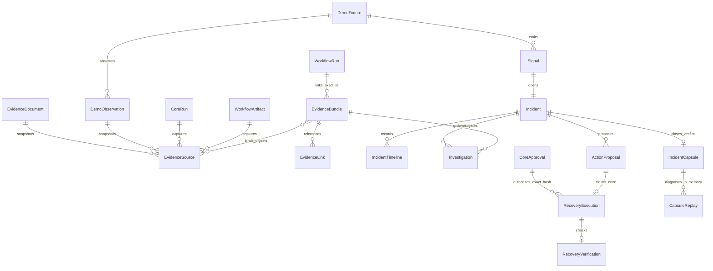
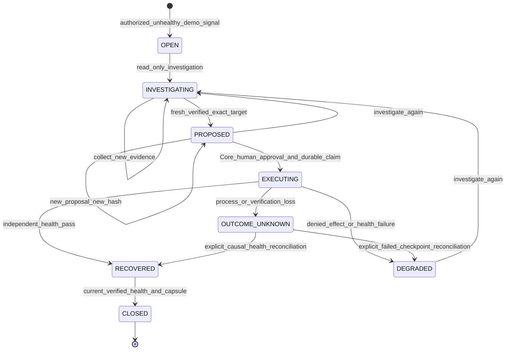

# Evidence and operational recovery contracts

Scope: supplied Studio PRD v1.2 §12–13 and Prompt 04, BR-01–07 / RL-01–08 / BN-05–07. Core remains the existing authority. The identifiers refer to the supplied PRD; absent normative PDFs have not been reviewed. No new identity, approval, execution owner, signer or promotion authority is introduced.

## Records and provenance

`packages/contracts/intelligence.py` rejects unknown fields, caller actor identity, arbitrary actions, commands, URLs, host paths and caller-supplied hashes. Every stored record binds organization/project, timestamp, indexed relationships, canonical JSON signature and the existing independent protected history head. Database rows are insufficient without their Core signatures and protected commitments. Append-only SQL guards protect immutable records; mutable fixture/incident/execution checkpoints cannot be erased or replaced. Every API read authorizes the current scope, and every mutation rechecks membership inside its transaction.



Sources are bounded 64 KiB snapshots. Internal artifact/run adapters retain existing manifest, claim, digest and lineage verification. Workflow, evaluation and authenticated tool-activity sources reuse their existing repositories and graders. Local file and raw Git-blob sources use server-prepared project bindings; browser selection contains only connection IDs and approved logical file keys. Regular files must be physical, bounded UTF-8, without links, reparse points or shared hard links, and retain the same identity throughout collection. Git reads require exact commit IDs and a contained, pinned object database; no checkout, hooks, filters, lazy fetch or network is allowed. Current HEAD drift cannot falsely support a current-revision claim. Missing/changed/revoked origins abstain. User documents and historical database-fixture observations retain their explicit demo classification. General external document connectors are unavailable.

Source retrieval rechecks the origin and snapshot digest/length/MIME, reconstructs sanitized content, and reports quality, observed_at, collected_at and maximum age (up to seven days). `UNVERIFIED` sources have no claim-bearing excerpt. Freshness is calculated on each read; future-dated or stale evidence cannot supply required coverage. Bundles preserve immutable collection status separately from current evaluation. The status filter refers explicitly to collection status. Two wrappers of the same origin count as one source. Distinct observations are coverage, not proof of statistically independent causality.

Typed predicates cover literal text, Core run/workflow completion, verified evaluation result, authenticated successful tool activity, exact Git revision, target configuration identity, measured resource bounds and service health. Each requires its exact subject or target; unrelated observations remain neutral. Resource limits are never represented as measured usage. There is no inferred root cause or fabricated confidence score. Missing/changed/unverified sources or insufficient fresh applicable coverage produce explicit abstention. Literal absence produces `NOT_FOUND`; negative measurements produce `CONFLICTING`, retaining counter-evidence. Optional model interpretation is separately labeled informational, requires explicit provider consent and a published assigned agent without effectful tools, and uses the existing budgeted Core/Hermes/9Router run path. It cannot change evidence status or grant execution authority.

EvidenceLink binds the exact existing run/artifact/workflow_run/incident/capsule/replay ID to a bundle. Linking a WorkflowRun does not recreate execution or lineage. Related queries authorize the target first and use scoped bounded pages. List continuations are verified record references, never bearer authority. Default page size is 25, maximum 100; source count per bundle is 16. Retrieval is bounded by these limits, though protected-head verification still uses the existing Core commitment store.

## State, approval and effect



Incidents deduplicate within organization/project; actual service signal identity derives from target instance and measured generation rather than caller keys. Healthy telemetry cannot invent a failure. Signal, severity, original source, owner, event actor/time/reference and legal revisions are server-owned. State changes and immutable timeline/audit entries commit together. Lock ordering is target, incident, execution; PostgreSQL contention uses row locks and unique constraints. Authenticated CSRF-checked cancellation can bypass the HTTP mutation serialization lock to reach Core fencing while another request is awaiting execution. Other mutations retain serialization; cancellation never bypasses Core permission or ownership checks.

Proposals bind target ID/revision, bundle ID/digest, empty parameters, fixed action, preconditions, reversible intent and health contract to a canonical payload hash. New proposals create new immutable IDs/hashes. The existing Core ApprovalEngine grants and verifies human `relay_action` receipts; it continues its unchanged agent-version Bench/regression policy. UI identity/confirmation has no authority. Actor permission and approver's current human authority, exact receipt and hash are checked at admission and again in the effect transaction. Admin may approve/reconcile; operator needs existing create/run permissions and cannot approve; project viewer can read and cannot mutate. No browser token extends authority after membership revocation.

The historical `restart_demo` path remains a fixed database-fixture operation and is labeled Demo Fixtures in Web. It is distinct from actual service execution. `restart_service` operates only on a trusted registered disposable Docker target: immutable image/container identity, tenant/project labels, network none, no published ports or mounts, read-only root, UID 65532, all capabilities dropped, no new privileges, 128 MiB memory/swap, 0.5 CPU and 64 processes. Inspection precedes observation and dispatch; overridden environment or isolation drift denies execution. The controller owns a real business subprocess. A separate observer measures its actual HTTP response. The browser cannot choose Docker IDs, image paths, commands, host files or network destinations. Database/authority-host compromise remains a trusted-host concern; possession of both signing keys and protected storage is outside these proofs.

Operational proposals bind target generation, parent instance, configuration/grant revision, binding identity, evidence bundle, fixed empty-parameter action, isolation/resources, five-minute expiry, fifteen-second deadline, required human approval, expected impact and verification. Automatic compensation is unsupported because stopping a recovered process may discard new work. Core persists the execution claim before dispatch, signs exact admission using the existing signer, rechecks operator and approver authority immediately before effect, and enforces six durable claims per hour. An unresolved claim fences another effect even after the quota window. Operational recovery is a human operator control-plane action; agents do not inherit its authority. Native agent tools remain separately mediated by existing Core grants/reviews and the isolated Hermes worker.

The execution dialog keeps a separate Core cancellation action reachable while the
original request is pending. It fetches the exact scoped current revision and calls
the existing cancellation endpoint; it does not abort transport, release ownership
or report an already dispatched effect undone. Confirmation and uncertainty are
displayed separately. Source roots must be explicit physical absolute directories;
UNC roots, external Git config includes and redirected Git common stores are denied.

Each real target also holds a protected signed admission anchor. Execution records
link to the previous admission; bounded direct signature/head-verified traversal
enforces the hourly quota and unresolved-effect fence without trusting mutable SQL
status/timestamp filters. The anchor and execution claim commit together before
dispatch. A physical container/environment cannot be registered through multiple
manifest aliases to reset those controls. Historical demo contracts remain intact;
an older unanchored operational checkpoint cannot authorize a new effect silently.

Reversible intent captures actual before-state; no automatic rollback is exposed. Only the legacy database-fixture effect and checkpoint are atomic. A real subprocess effect cannot commit atomically with the application database: Core first persists admission, and transport/process/checkpoint ambiguity becomes OUTCOME_UNKNOWN. Independent verification requires the exact parent instance, before-generation+1, execution ID in both controller receipt and child identity, and actual healthy business HTTP response. Action return never implies health recovery. Failed verification leaves DEGRADED and cannot close. Closure probes again, so intervening changes cannot reuse an old receipt.

A process/verification loss retains OUTCOME_UNKNOWN. Startup fences stale workers and records unresolved prior-owner claims; it never replays the action. The original idempotency key returns the existing result, binds actor/incident/proposal/hash, and cannot dispatch twice. An explicit admin reconciliation checks expected incident revision and actual signed checkpoint. It may establish a failed unchanged unhealthy before-state or a causally recovered after-state. Unrelated/superseded effects remain unresolved; they cannot borrow another execution's healthy state.

## Safe replay and promotion boundary

Historical demo closure keeps its original capsule format. Actual service capsules can capture `RECOVERED`, `DEGRADED` or `OUTCOME_UNKNOWN` without falsely closing an incident. They retain signed incident, signal, investigation, proposal, original approval identity, admitted execution/receipt, optional independent verification/measurement and sanitized source bytes. Unknown recovery is null, not success. Every lineage identity, hash, signature and source byte is revalidated. Later reconciliation preserves the original immutable checkpoint. Archive integrity is distinct from current source freshness; archived evidence never confers new execution authority. Missing/tampered evidence prevents replay.

`InMemoryRecoveryReplay` has no Core, database, runtime or live executor capability. It copies the captured boolean state, performs one actual in-memory restart and emits that action trace. Existing pure Bench schema, forbidden-action, integrity and latency/resource graders check the diagnostic scenario. Malicious escaped action evidence fails the report and cannot mutate live fixture state. Persisting a signed diagnostic report/audit/link is an application storage write, distinct from a live remediation call; `live_write_calls=0` concerns remediation effects. Report model/provider are null, backend is `deterministic_in_memory`, tokens are zero because no inference occurred, and cost/provider traces are unavailable. Generic grader plumbing uses the internal `not_applicable` sentinel without representing it as a provider model.

The diagnostic contract never replaces Agent promotion graders: `promotion_evidence=false`. A capsule or verified failed evaluation may explicitly propose a bounded declarative regression candidate. Existing human Core approval must review its exact digest before a suite can adopt the unchanged declaration. The immutable suite then requires its own review, and Factory/Bench/publication retain their existing gates. Nothing automatically accepts a baseline, runs a candidate or publishes an agent.

## Persistence, API and rollback

Migration `019_intelligence_recovery` follows 018/017/016/015. It creates fifteen empty tables and scoped/status/target/reference indexes with frozen additive DDL, no historical backfill. Restricted PostgreSQL writer requires SELECT/INSERT on immutable intelligence tables, UPDATE only on mutable checkpoints, no DELETE/TRUNCATE, no schema CREATE/ownership. Existing governance and workflow privileges/triggers remain required. New rows use application canonical timestamps so signatures match SQLite and PostgreSQL timestamp normalization.

Scoped APIs under `/api/projects/{project_id}`: `/brief/documents`, `/brief/sources`, `/brief` list/create/detail/download, `/brief-links`; `/relay/demo-fixtures` create/list/change, `/relay/signals`, `/relay` list/detail/timeline/investigate/proposals/approve/execute/reconcile/close, `/relay/capsules/:id` read/download; `/bench/capsules/:id/replay` with empty typed payload and `/bench/replays` list/detail. Query keys are allowlisted and duplicate keys denied. All mutation endpoints retain existing session/CSRF/origin/body limits; exports use generated opaque attachment names, JSON/plain text, no-store, nosniff and restrictive CSP.

Downgrade first checks every new table count and refuses populated intelligence history before any drop. An empty rollback can remove only these new tables in reverse dependency order. Production rollback requires preserving both the database and existing protected signing/commitment/authority host storage, then reviewing compatibility; an old application must not be allowed to mutate newer checkpoints. No production migration/deployment is executed by this delivery. Live tests use separate disposable owner and restricted application roles with PostgreSQL 16.13, with no SQLite fallback.

## Threat verification

| Threat | Enforcement and actual regression |
|---|---|
| Fabricated source/client digest, path/URL/command | Typed extra-forbid contracts, existing artifact/run origin proof; ingestion/proposal/replay negative tests |
| Source blob/MIME/document missing or tampered | Immutable signature/protected head + digest/MIME reconstruction; SQLite and owner-corruption PG tests produce UNVERIFIED abstention |
| Low coverage, stale/future evidence, duplicate wrappers, unrelated target observations | Distinct applicable origin coverage, exact health target and read-time freshness; no proposal from abstention; SQLite and PostgreSQL cross-target regression |
| Cross-project/source/capsule reads, viewer mutation | Current Core scope and permission checks; backend and browser error/switch cases |
| Unapproved/modified/stale target/hash/receipt | Existing Core human exact-hash verification at both admission and commit; no effect row/fixture mutation |
| Same-key concurrency/repeat requests | Database uniqueness, fixed target lock, durable idempotent claim; competing service admissions and HTTP repetitions |
| Successful action but failing health | Independent verifier leaves DEGRADED; close rejected; changed health rejects old verification |
| Crash before/after effect or verification loss | Durable checkpoint, fencing, OUTCOME_UNKNOWN and explicit reconciliation; no retry |
| Capsule replay live effects/promotion | Capability-free copy adapter, action-trace graders, live executor monkeypatch that raises, fixed false promotion eligibility |
| Application writer rewrites/deletes evidence | SQLite triggers and PostgreSQL denied UPDATE/DELETE/TRUNCATE; signed index mirrors and protected heads |

## Additive contracts and Web control plane

Migrations 025–027 add immutable suite versions/candidates, scoped source connections/references, informational interpretations, operational capsules and diagnostic replays. All 24 historical migrations and signatures remain intact; no history is rewritten or fabricated. Registered real targets reuse the historical target/observation anchor tables with a typed `isolated_service` discriminator to preserve existing foreign keys. New capsule tables preserve the older recovered-only contract. Downgrade refuses populated new history. Restricted PostgreSQL writers cannot rewrite or erase immutable rows.

Existing Bench, Brief, Relay and Factory pages expose the typed operations. Brief adds source connections and separate interpretation; Bench adds versioned authoring/review, authenticated tool receipts, unavailable usage metrics, signed regression export and reviewed candidates; Relay adds registered targets, probe snapshots, exact proposal/approval, cancellation and historical capsules. Current backend RBAC remains authoritative. Source roots, administrative endpoints, server credentials and Docker identities never become browser configuration.

Additional scoped APIs under `/api/projects/{project_id}`:

| Contract | Endpoints |
|---|---|
| Trusted source selection | `/brief/connection-bindings`, `/brief/connections`, `/brief/connections/{id}/grant`, `/brief/collect` |
| Informational assigned execution | `/brief/interpretation-agents`, `/brief/{id}/interpret`, `/brief/{id}/interpretations` |
| Reviewed declarative evaluations | `/bench/suite-versions`, `/bench/suite-versions/{id}/review`, `/bench/scenario-candidates`, `/bench/scenario-candidates/{id}/review` |
| Signed regression export | `/bench/evaluations/{id}/regression/download` |
| Registered target lifecycle | `/relay/target-bindings`, `/relay/targets`, `/relay/targets/{id}/grant`, `/relay/targets/{id}/observe` |
| Cancellation and checkpoints | `/relay/{id}/cancel`, `/relay/{id}/capsule`, `/relay/capsules` |

Trusted startup uses `services.api --operational-bindings <operator-manifest> --evidence-bindings <operator-manifest>`. Manifests are server-side configuration and contain no provider keys. Registering or revoking a connection changes configuration identity and invalidates mismatched evidence/admission. Existing credential bootstrap/lifecycle and the sole 9Router production model gateway remain unchanged.

Reproduce actual service/Git/runbook demonstrations with `tests/operational_intelligence_check.py` and the [infra lifecycle](https://github.com/aryn-labs/aryn-infra/blob/main/docker/operational_targets/README.md). `tests/native_worker_check.py` additionally runs a reviewed persisted Bench suite through actual Hermes-native handlers, a deliberate regression, rejected promotion and a passing publication in a disposable database; model decisions are explicitly offline doubles. Browser tests default to an explicit operational protocol double and real file/Git reads; setting `ARYN_TEST_OPERATIONAL_MANIFEST` uses a real isolated Docker service for the same Web flow. Neither mode invokes a live provider.

The installed Hermes 0.21.6 revision `3637c512fc3211bdccb61b7140d09ac1018508ba` supports the reviewed isolated terminal/file/patch/search handlers. Other native capabilities remain non-executable unless Core can mediate and isolate them. 9Router 0.5.91 still lacks immutable upstream `provider_configuration` evidence; live model admission stays blocked. CPU/memory utilization, upstream retries, billing and provider identity beyond available evidence remain unavailable. General customer-infrastructure recovery, hosted IdP/network/secret-manager deployment UAT and current commit-bound CI delivery remain unverified. Historical 14/14 CI on `d6425d7` does not certify uncommitted changes. Automated axe/keyboard/overflow checks are observed accessibility evidence, not external certification.

## Local integration verification — 2026-10-19

Validation used application ancestor `d6425d72ca695e14b92f3961ca00135c4d464351`, infrastructure ancestor `939e4a48bd759c18f4f8213ad59a749f47f3e746` and documentation ancestor `e826deba288803d8d52d51e176be5e4d8ab0fd04`. These are ancestor identities, not commits containing the local changes. No commit, push, hosted deployment or provider inference was performed.

| Actual check | Result |
|---|---|
| Complete Windows offline backend/security suite | 1,757 passed; 5 existing skips; 1,027.47 seconds |
| Complete Linux offline backend/security suite | 1,739 passed; 23 existing skips; 1,065.94 seconds |
| Linux regressions for changes after its full-suite checkpoint | 65 passed; no skips |
| PostgreSQL 16.13 with actual restricted application roles | 160 passed; no skips |
| Actual installed-version Hermes API boundary | 1 passed; no skips |
| Actual isolated Hermes worker and persisted Bench workflow | 6 observations passed, including deliberate regression, denied promotion, reviewed passing publication and Brief tool receipts; model decisions were offline doubles |
| Frontend components | 130 tests passed across 18 files; formatting, lint, typecheck and production build passed |
| Browser regression | 197 passed across seven suites; all 21 intelligence cases passed with a real isolated Docker target, including exact Git revision, approval/recovery, independent verification and capsule replay |
| Infrastructure lifecycle unit checks | 5 passed |
| Real disposable service and source demonstrations | Passed healthy/fault/denied/approved recovery, idempotency, revoked grant, unknown reconciliation without redrive, actual unhealthy verification, signed capsule/reviewed candidate, Git/runbook/telemetry and changed-source abstention |
| Static/package checks | Ruff, repository hygiene, actionlint, offline lock consistency and wheel/sdist build passed; all 33 changed production Python files matched the wheel; legacy Gemini/Mock/Nous inference adapters were absent |
| Dependency audit | 89 application Python distributions, 119 native Python distributions and 613 Node packages; no known advisories reported |
| Secret scan | Entire Git history: no findings. Current source: raw exit 1 for two unchanged synthetic security-test fixtures; reviewed new findings: zero. The raw result was retained, not suppressed |

Both backend collections contain the same 1,762 test identities: all 1,691 baseline identities plus 71 additions. JUnit executions match the selection manifests, and skip identities match baseline. The local single Windows selection is not the four-shard, commit-bound CI certification. All 24 historical migrations remain byte-equivalent after line-ending normalization.

The full Linux checkpoint has source fingerprint `c3f269235dc10d926ba69b71b4b8f06e70de8ac5d90aef279409ec016219514b`. Subsequent source identity/physical-target alias/Git-fixture changes were covered by the 65 current Linux regressions and full current Windows run, at application fingerprint `11e7ee0af4230d6818cb4ddb4f5c333fda5878f7f5a1b6a821fea657ffcaf8e4`. Source fingerprints, per-file inventories, actual commands, raw logs, JUnit, stage timings and demonstration receipts are retained under the application's ignored `.local/operational-intelligence/` directory, with `verification-summary.json` as the review index. Linux aggregate worker time was setup 851.36 seconds, call 2,269.31 seconds and teardown 18.84 seconds; these sums are concurrent worker time, not wall time. The Linux CI timeout remains 20 minutes, and all quality gates remain unchanged.

Reproducible commands from the application checkout (activate its locked development environment first, with `PYTHONPATH=.` and `ARYN_RUN_LIVE_MODEL_TESTS=0`):

```text
python -m pytest -m "not postgresql" --backend-shard=1/1 -n 3 --dist worksteal -q --tb=short --durations=25 --timing-report=.local/backend-timings.jsonl --junitxml=.local/backend.xml
python -m pytest tests/postgresql -q --tb=short
python tests/native_worker_check.py --manifest .local/native-worker/manifest.json
python -m pytest tests/integration/test_hermes_9router_binding.py -q --tb=short
python -B -m unittest discover -s ../aryn-infra/tests -v
```

The actual Linux/PostgreSQL/API commands ran in reviewed local Docker images with frozen credential-free source snapshots; PostgreSQL explicitly set `ARYN_TEST_POSTGRES_ADMIN_URL` for its disposable provisioning role. Native API verification explicitly set `ARYN_TEST_HERMES_SOURCE` and `ARYN_TEST_HERMES_PYTHON` to the reviewed SDK image. Live provider tests remained opted out. Exact container commands are retained in `verification.ps1`; current Linux/Web/service commands are in `complete_verification.ps1` in the same ignored evidence directory. Infrastructure creation, fault injection and identity-checked destruction follow the [operational target instructions](https://github.com/aryn-labs/aryn-infra/blob/main/docker/operational_targets/README.md).

From `apps/web`, run `npm run format:check`, `npm run lint`, `npm run typecheck`, `npm test`, `npm run build`, then all seven existing Playwright scripts. The recorded real-service Web run set `ARYN_TEST_OPERATIONAL_MANIFEST` to the scoped operator-created manifest before `npm run test:intelligence:e2e`; omitting it explicitly uses the test protocol double. All owned demonstration containers and their environment-specific image tags were removed after verification. The global Hermes source/configuration was unchanged. Exact-SHA CI, real-provider admission and hosted operational validation remain separate authorization/environment requirements; none is implied by these results.

## Native dependency compatibility — 2026-10-26

The source/integration changes were delivered to application commit `0f6b1078e760427f6c07fcfb0940fbec0d598845` and infrastructure commit `678b589f939121b63b70f9257773d262ab806492`. Current advisory data subsequently rejected the older Python/native/frontend dependency versions. Application commit `8b0b7202adf381cf684e57c157b897a110af41d9` updates certifi to 2026.10.19, filelock to 4.2.1, setuptools to 84.1.0, Pillow to 13.0.0 and Zod to 4.6.6. The native API overlay and worker export use the same hashed application security/runtime dependency closure. Local audits covering 90 installed Python distributions and 613 Node packages reported no known advisories; 12 audit/gateway guard tests, 130 frontend tests, TypeScript and package builds passed.

**BLOCKED:** the reviewed Hermes source depends on `browser-harness==0.1.13`, whose published metadata requires `pillow==12.3.0`. The latest upstream source at `4ced8e0087d2d45ea2d08c00cb62449b2d94a90e` retains that exact pin. Its image dependency therefore conflicts with the secure Pillow 13 overlay. [The current native CI](https://github.com/aryn-labs/aryn/actions/runs/40227673721) fails `uv pip check` before native imports/execution rather than accepting the incompatible environment. The earlier native execution results above apply to the older dependency environment and do not certify the updated closure. Security, frontend and browser checks on the current application SHA passed; this is not a complete current delivery certification.

Upstream evidence: [published package metadata](https://pypi.org/pypi/browser-harness/0.1.13/json), [immutable dependency declaration](https://github.com/browser-use/browser-harness/blob/4ced8e0087d2d45ea2d08c00cb62449b2d94a90e/pyproject.toml), and the still-open [Pillow 13 dependency update](https://github.com/browser-use/browser-harness/pull/935). Resolution requires a compatible upstream release, or a separately reviewed maintained dependency patch with compatibility verification. No package metadata was forged, component silently removed, audit ignored, compatibility check disabled, or vulnerable version restored. Global Hermes/9Router installation and configuration remain untouched. Required Quality Gates and Validated Delivery Artifact remain authoritative; the blocked native check cannot produce a validated delivery artifact.
